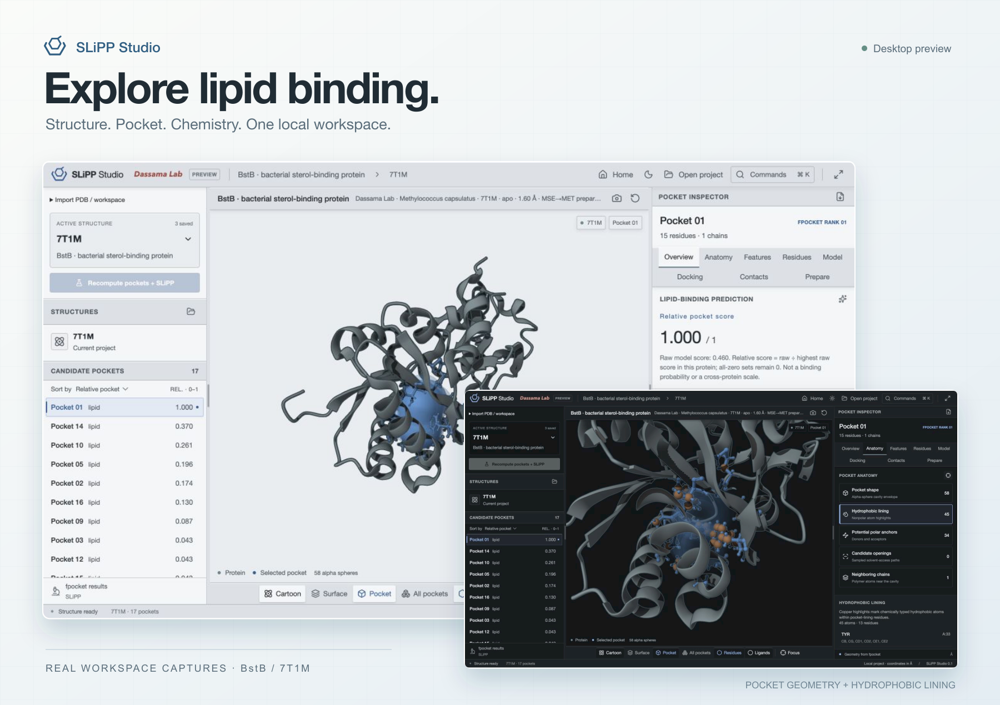
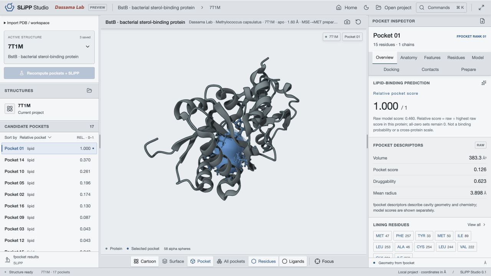
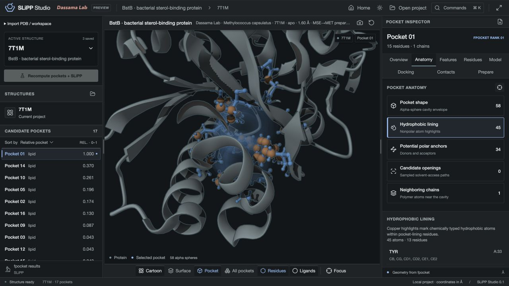

<p align="center">
  
</p>
<h1 align="center">SLiPP Studio</h1>
<p align="center"><strong>From protein structure to lipid-binding pocket.</strong><br>A local desktop workbench for exploring lipid–protein interactions.</p>
<p align="center">
  <a href="#get-started">Get started</a> ·
  <a href="docs/guide.md">User guide</a> ·
  <a href="docs/docking.md">Docking methods</a> ·
  <a href="docs/studio-paper/README.md">Software description</a>
</p>
<p align="center">
  
  
  
  
</p>



Open a protein, find its cavities, and follow the evidence into the structure. SLiPP Studio brings pocket geometry, lipid-binding scores, local docking and atom-level inspection into one workspace—with portable analyses you can reopen and share.

<table>
<tr>
<td width="33%" valign="top">
<strong>01 · Find the pocket</strong><br><br>
Inspect PDB or mmCIF structures in Mol*. Detect cavities with fpocket, rank them with SLiPP, and follow residues directly into the 3D view.
</td>
<td width="33%" valign="top">
<strong>02 · Explore the chemistry</strong><br><br>
Inspect cavity shape, hydrophobic lining, potential polar anchors and neighboring chains. Keep the structural context in view.
</td>
<td width="33%" valign="top">
<strong>03 · Inspect a pose</strong><br><br>
Screen prepared lipids with local Vina or Vinardo. Compare pocket × lipid results, inspect contacts, and export poses with run metadata.
</td>
</tr>
</table>

## A closer look

<table>
<tr>
<td width="50%"><a href="docs/media/pocket-overview.jpg"></a></td>
<td width="50%"><a href="docs/media/pocket-anatomy.jpg"></a></td>
</tr>
<tr>
<td valign="top"><strong>Geometry, scores and residues.</strong><br>The pocket list and inspector stay linked to the molecular view.</td>
<td valign="top"><strong>Chemistry in context.</strong><br>Explore the atoms that line a cavity without losing the surrounding protein.</td>
</tr>
</table>

*Actual app captures of apo BstB (7T1M), using the documented MSE→MET prepared reference. The hero layers screenshots; the molecular views and values are unaltered. [Reference provenance](demo/lipid-reference/README.md) · [Image details](docs/media/README.md)*

## Get started

**Preview software · build from source.** Requires Node.js 22.12+, Rust, and the [Tauri 2 platform prerequisites](https://v2.tauri.app/start/prerequisites/). The native app has been checked on macOS; other platforms have not been verified.

```sh
git clone https://github.com/filiprumenovski/slipp-studio.git
cd slipp-studio
npm ci
npm run tauri dev
```

From Home, choose **BstB reference analysis** to explore the bundled structure, 17 detected pockets and original SLiPP scores. The reference is included; no model download or scientific setup is needed to inspect it.

To detect pockets, score new structures and run local docking, install the scientific runtime once:

```sh
./scripts/setup-science.sh
```

The setup script requires a C toolchain, Git and uv. It builds pinned fpocket and installs the Python runtime. The original SLiPP forest is fitted and cached on first inference. The optional SaProt–EGNN model requires its separately supplied checkpoint and scientific checkout: [setup and model semantics](docs/geometric-model.md).

For a browser preview, use `npm run dev`. Protein inspection and workspace import work there; computation runs in the native app.

## Take the analysis with you

- **Portable `.slipp` workspaces** retain visited structures, preparation settings, lipid definitions, docking jobs, poses and provenance.
- **Local autosave** keeps analyses between sessions. Interrupted jobs resume only when requested.
- **PNG, CSV and SDF exports** cover molecular views, pocket tables and docked poses with metadata.
- **Light and dark modes**, presentation mode and keyboard commands keep the workspace comfortable at the bench or on a screen.

After setup, local analysis needs no hosted backend. Retrieving a new PDB entry requires a network connection; imported coordinates and the bundled reference can be inspected offline.

## Reading the results

SLiPP scores prioritize candidates. **Relative score is raw score ÷ the highest raw score in the same protein**; it is not a binding probability or a scale for comparing proteins. Raw outputs are retained.

The default predictor follows the original binary SLiPP recipe. The optional SaProt–EGNN integration uses one asymmetric fold-2 checkpoint with eight independent lipid-class outputs; it does not represent the final multi-view ensemble. Docking is exploratory: Vina and Vinardo scores are separate, and docking scores alone do not establish affinity or selectivity. See the [model provenance](scripts/inference/model/README.md), [geometric-model notes](docs/geometric-model.md) and [docking assumptions](docs/docking.md).

## Build and documentation

```sh
npm run build          # TypeScript check and production frontend
npm test               # UI invariants and Rust validation tests
npm run tauri build    # Package the native app
```

| Read more | |
| --- | --- |
| [User guide](docs/guide.md) | Navigation, structure libraries, analysis, docking and exports |
| [Project schema](docs/schema.md) | Normalized inputs, geometry and validation |
| [Docking methods](docs/docking.md) | Preparation, assumptions and interpretation |
| [Geometric model](docs/geometric-model.md) | Optional checkpoint installation and output semantics |
| [Software description](docs/studio-paper/README.md) | Dated implementation snapshot, source map and PDF |
| [Reference project](demo/lipid-reference/README.md) | Coordinate preparation and bundled result provenance |

Built with Tauri, Rust, React and Mol*. Pocket detection uses fpocket; docking uses AutoDock Vina/Vinardo. Component credits and upstream references are documented in the linked methods and model notes. The original SLiPP training table retains its [CC0 license](scripts/inference/model/LICENSE); that license applies to the table, not to the entire application.
